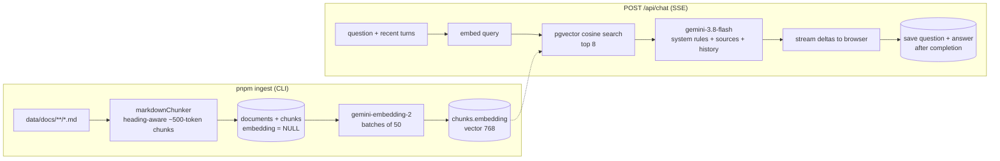

# Architecture — Gap Product Guru

How a question becomes a grounded answer, why the system is shaped this way, and where it
deliberately differs from `regionify`. Start here; every other doc goes deeper on one part.

---

## Why traditional RAG

The documentation is >700k words — roughly **1.0–1.2M tokens** once Markdown and code are counted.
Gemini 2.5 Flash can technically take ~1M tokens of context, but sending the whole corpus with every
question would be slow, would blow straight through free-tier token-per-minute limits, and dilutes
the model's attention. Instead each question sends only the **8 most relevant ~500-token sections**
(~4k tokens of context, ~5–8k tokens per request in total).

Rejected alternatives:

- **Whole corpus in context / context caching** — too many tokens per request for the free tier.
- **LangChain / LlamaIndex** — a few hundred lines of plain code do the same job here, with nothing
  to learn or upgrade.
- **A dedicated vector database** — pgvector keeps vectors next to conversations in the one
  Postgres we already run; at a few thousand chunks an exact scan is milliseconds.

## Two flows

### Ingest (offline, re-runnable)

1. Scan `DOCS_DIR` for `.md` files; hash each (content + chunker version + embedding model).
2. New/changed file → replace its document and chunks (embeddings empty). Unchanged → skip.
   Deleted file → remove its rows.
3. Embed every chunk that has no vector yet, in batches; stop cleanly when the daily quota runs out.

Details: [INGESTION.md](./INGESTION.md).

### Chat (per question)

1. Route validates the body, checks the conversation belongs to this browser, then opens an SSE stream.
2. `status: retrieving` → embed the question (plus the previous question for short follow-ups) →
   cosine search → `sources` frame.
3. `status: generating` → Gemini streams the answer → `delta` frames.
4. On completion the question and answer are saved together → `conversation` frame → `[DONE]`.

Details: [RETRIEVAL_AND_PROMPTING.md](./RETRIEVAL_AND_PROMPTING.md),
[STREAMING_PROTOCOL.md](./STREAMING_PROTOCOL.md).

## Components

| Piece              | Where                                                                  | Notes                                            |
| ------------------ | ---------------------------------------------------------------------- | ------------------------------------------------ |
| Chunker            | `server/src/ingest/markdownChunker.ts`                                 | Pure, unit-tested                                |
| Ingest CLI         | `server/src/ingest/index.ts`                                           | `--dry-run` for stats                            |
| Gemini wrapper     | `server/src/lib/gemini.ts`                                             | Client, embeddings, config, error mapping        |
| Vector SQL         | `server/src/repositories/chunkRepository.ts`                           | Raw SQL — Prisma can't model `vector`            |
| Prompt building    | `server/src/services/chatPrompts.ts`                                   | Everything the model sees                        |
| Chat stream        | `server/src/services/chatService.ts`, `routes/chat.ts`                 | Async generator → SSE                            |
| Conversations      | `server/src/services/conversationService.ts`                           | Scoped by anonymous client id                    |
| Feedback / admin   | `services/feedbackService.ts`, `routes/messages.ts`, `routes/admin.ts` | 👍 / reports; open admin API                     |
| Share links        | `services/shareService.ts`, `routes/shares.ts`                         | Snapshot links, "continue" copies them           |
| Product areas      | `lib/docAreas.ts`, `services/docsService.ts`                           | Top-level wiki sections for the filter           |
| SSE client         | `client/src/api/chat/index.ts`                                         | fetch + ReadableStream (POST, so no EventSource) |
| Chat orchestration | `client/src/hooks/useChat.ts`                                          | URL ↔ conversation, ask/stop/retry               |

## Data model

`documents` 1—n `chunks` (with `embedding vector(768)`), `conversations` 1—n `messages`.
Messages are stored as user/assistant pairs; assistant messages keep the sources they cited.
`message_feedback` and `shared_conversations` keep their own copies of the content they refer to.
See [DATABASE.md](./DATABASE.md).

## Identity

There is no login. The client generates a random UUID once, keeps it in `localStorage`, and sends it
as `X-Client-Id`; conversations are filtered by it. This is **scoping, not security** — acceptable for
an internal tool, and the first thing to replace if the app is ever exposed publicly.

## Deviations from regionify

| regionify                                        | Here                                                      | Why                                                                          |
| ------------------------------------------------ | --------------------------------------------------------- | ---------------------------------------------------------------------------- |
| Client calls absolute `VITE_API_BASE_URL` + CORS | Relative `/api`, Vite dev proxy, Express serves the build | Same origin in dev and prod → no CORS config, custom headers just work       |
| Routes mounted at root (nginx subdomain)         | Routes under `/api`                                       | The same server also serves the SPA                                          |
| Prisma 6, `prisma-client-js`                     | Prisma 7, `prisma-client` generator + `adapter-pg`        | Current major; pinned to `~7.10.0` because `prisma@latest` is an 8.0 RC      |
| zod 3                                            | zod 4 (`z.url()`, `z.uuid()`, `z.flattenError`)           | Current major                                                                |
| SSE disconnect via `req.on('close')`             | `res.on('close')` + `AbortController`                     | `req` closes as soon as the body is read — see STREAMING_PROTOCOL.md         |
| SSE error frames are plain strings               | `{ code, message, retryAfterSeconds }`                    | The UI must tell rate limits apart from failures                             |
| Redis sessions, auth, Sentry, i18n, Loki/Grafana | None                                                      | Local internal tool; listed as follow-ups in README                          |
| `FeedbackProvider` wrapping `App.useApp()`       | `App.useApp()` directly                                   | Only a handful of toasts; the wrapper wasn't worth its code                  |
| No tests                                         | vitest for the chunker and Gemini error mapping           | The two places where silent bugs would hurt answer quality or quota handling |
